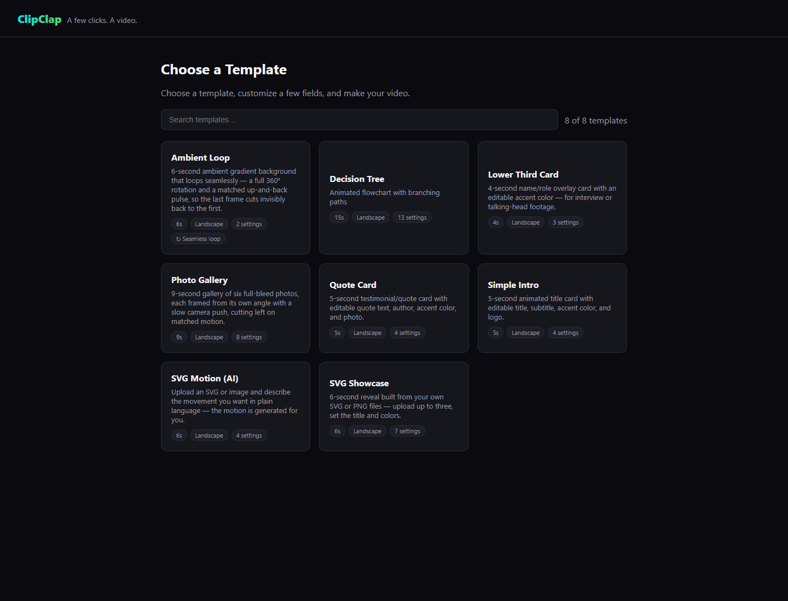

# ClipClap

**Pick a template. Make it yours. Export a video on your Windows PC.**

[](https://github.com/guardyanz/clipclap/actions/workflows/clipclap-checks.yml)
[](LICENSE)
[](https://github.com/guardyanz/clipclap/releases)

ClipClap is a Windows desktop application and local browser workflow built on [HyperFrames](https://github.com/heygen-com/hyperframes). Start with a short form, or switch to the full Studio editor with a timeline and live preview. Rendering runs locally with Chromium and FFmpeg.

**[Download the Windows beta](https://github.com/guardyanz/clipclap/releases/tag/v0.1.0-beta.1)** · [Screenshots and demo](docs/clipclap/SHOWCASE.md) · [What changed from upstream](UPSTREAM.md) · [Contribute](CONTRIBUTING.md)




*Five-second output from the packaged app. [Download the MP4](https://github.com/guardyanz/clipclap/releases/download/v0.1.0-beta.1/clipclap-simple-intro-demo.mp4).*

## What ClipClap adds

- An Electron Windows application with a local wizard and full Studio mode.
- Eight form-driven starters, including photo gallery, ambient loop, quote card, intro and SVG showcase templates.
- Portrait, landscape and square export choices in Studio.
- Bundled template and block registries, with local preview thumbnails when available.
- Loop seam checks and a seamless ambient-loop starter.
- An English interface, source documentation and contributor guides.
- Upstream usage analytics disabled in this distribution.

This is a curated downstream project, not an official HeyGen release. HyperFrames' renderer, Studio and substantial framework code remain credited to their original authors. The original documentation is retained in [README.upstream.md](README.upstream.md).

## Try the Windows beta

Download `ClipClap-Setup-0.1.0-beta.1.exe` from [Releases](https://github.com/guardyanz/clipclap/releases), compare its SHA-256 with `SHA256SUMS.txt`, and run it. Use **Easy Mode** to choose a template, or **Full Editor** for Studio.

The beta installer is unsigned. Windows may show an unknown-publisher notice. It requires no separate Node.js or FFmpeg installation. Chrome/Chromium availability is checked by the rendering workflow; the Windows browser runtime must be available. Some templates use remote fonts or media; AI-assisted motion requires your own provider configuration and is optional. ClipClap does not provide an AI subscription.

## Run from source

Requirements: **Node.js 22+**, **Bun 1.3.14+**, FFmpeg/ffprobe and a Chromium browser. Package names retain `@hyperframes/*` for internal compatibility; no npm publication is required.

```sh
git clone https://github.com/guardyanz/clipclap.git
cd clipclap
bun install --frozen-lockfile
bun run build:clipclap
node packages/cli/bin/clipclap.mjs wizard --no-open
```

Open the loopback URL printed in the terminal. To launch the desktop shell from the source checkout:

```sh
bun run --filter @hyperframes/desktop dev
```

For a Windows installer, see [the desktop build guide](packages/desktop/README.md). The public CI builds the CLI and desktop entry point and runs the downstream regression tests. Large generated upstream regression outputs are excluded from this source snapshot.

## Contribute

Good starting points are additional form-driven templates, Windows packaging, offline previews, accessibility and focused wizard/Studio regressions. Run the changed package's tests and the downstream checks described in [CONTRIBUTING.md](CONTRIBUTING.md). Avoid committing renders, installers, credentials or local user projects.

## License and provenance

Apache-2.0. Keep [LICENSE](LICENSE), [NOTICE](NOTICE), upstream credits, and individual asset notices when redistributing. Bundled dependencies retain their own licenses. See [UPSTREAM.md](UPSTREAM.md) for the source snapshot and scope of this fork.
