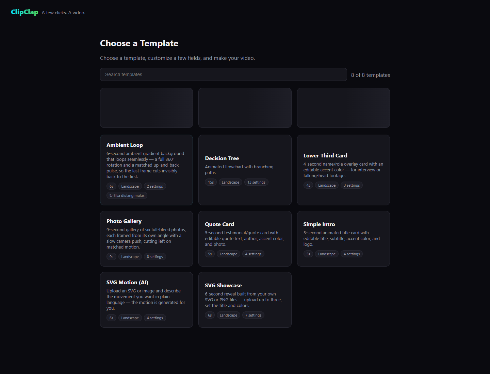
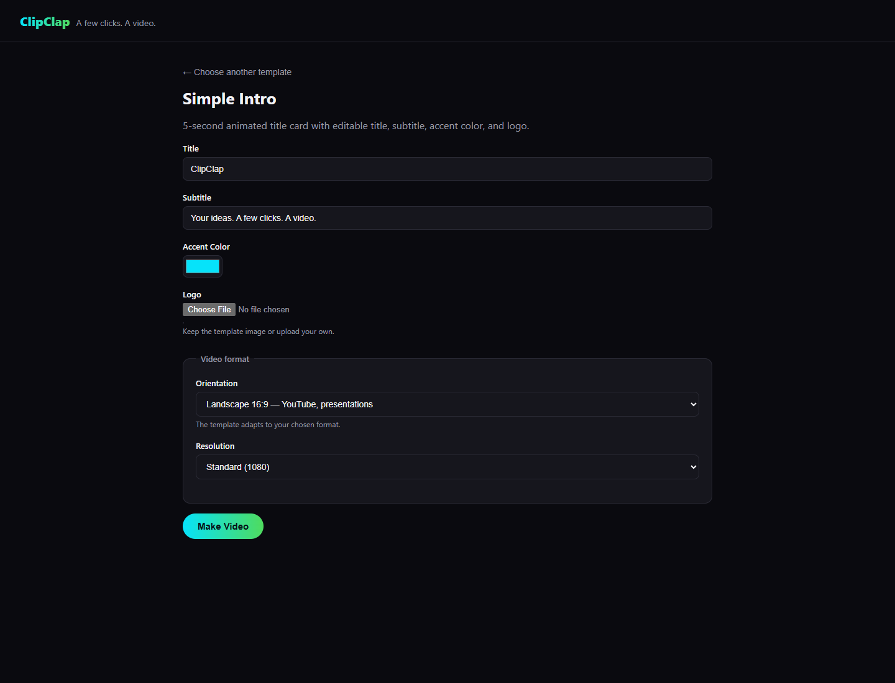
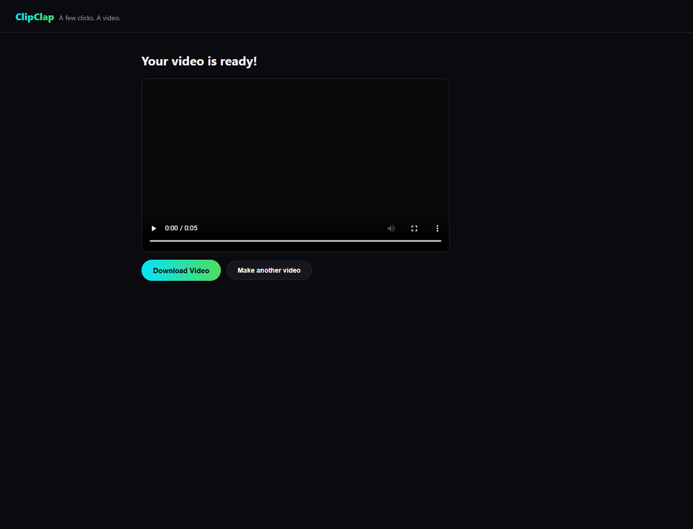

# ClipClap in action

These are screenshots of the running English wizard, not design mockups. The local workflow uses the same template server as the Windows desktop application.

## Choose a template

## Customize the title card

## Render and download

Download the [five-second demo MP4](https://github.com/guardyanz/clipclap/releases/download/v0.1.0-beta.1/clipclap-simple-intro-demo.mp4) to inspect the actual export. It was rendered locally from the included `simple-intro` starter, using the title **ClipClap** and subtitle **Your ideas. A few clicks. A video.** No AI provider or API key was used.

The beta release also includes the unsigned Windows x64 installer and SHA-256 checksums. Some templates fetch remote fonts/media. First-run Chromium setup needs internet when a compatible browser is not cached.
